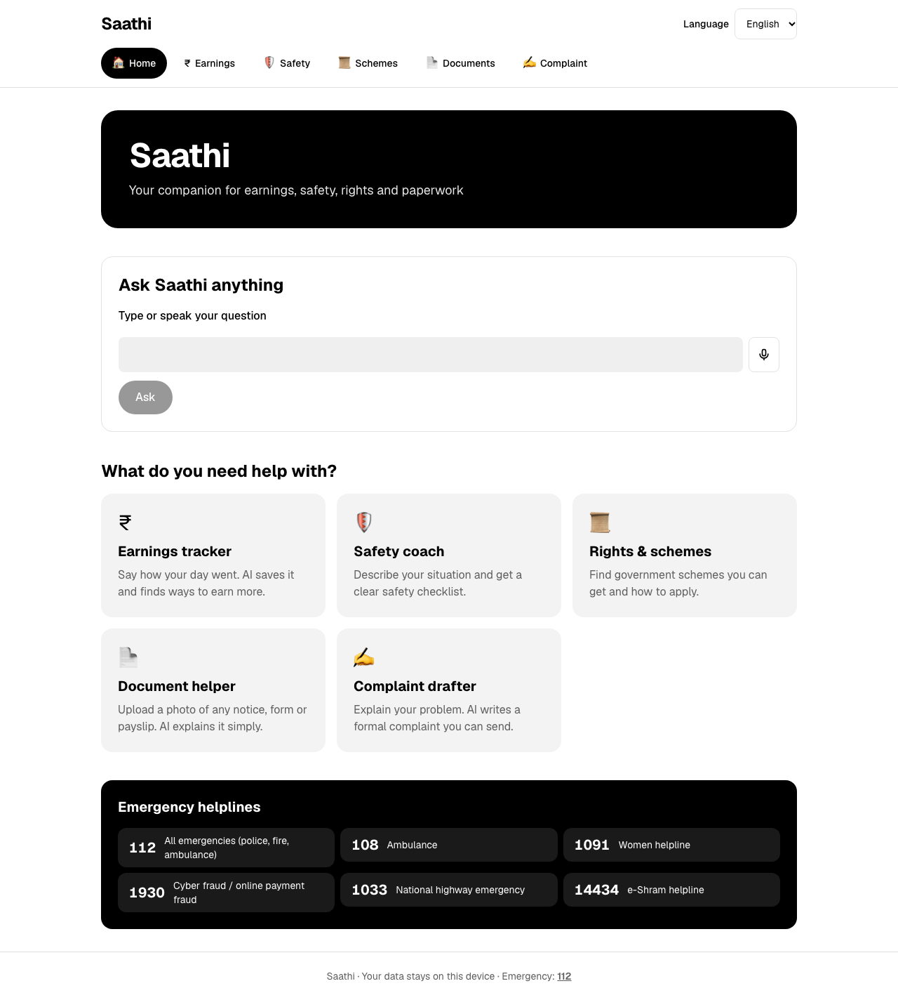
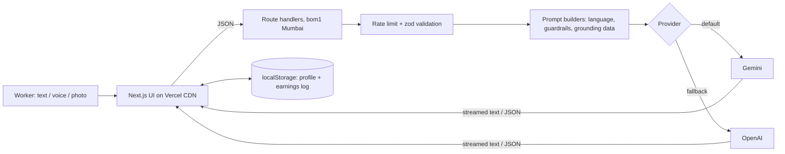
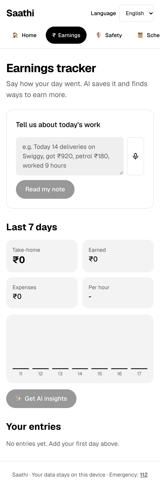
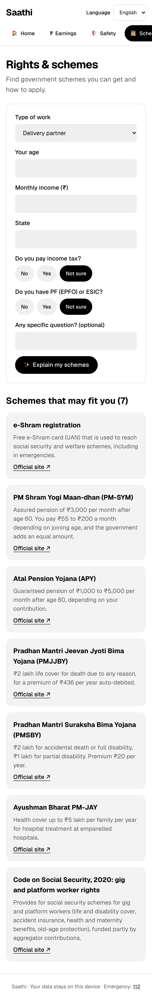
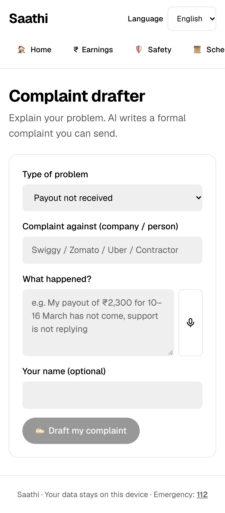

# Saathi: Gig Worker Companion

> A multilingual GenAI assistant for delivery partners, drivers and daily-wage workers. It helps them track earnings, stay safe, find welfare schemes, understand documents, and draft complaints, in simple English, Hindi or Punjabi, by typing or speaking.

**Live demo:** https://YOUR-APP.vercel.app · **Demo video:** https://VIDEO-LINK



## The problem

India has millions of gig and informal workers. Most don't track what they actually take home after fuel and commissions. Many don't know which government schemes they qualify for, and they struggle with official notices and contracts. When a payout is withheld or an account is blocked, few can write a formal complaint. Language and literacy make all of this harder.

## The solution

Saathi puts five connected AI tools behind one simple, mobile-first interface:

| Feature               | What the worker does                                                 | What the AI does                                                                                                                                                                                               |
| --------------------- | -------------------------------------------------------------------- | -------------------------------------------------------------------------------------------------------------------------------------------------------------------------------------------------------------- |
| **Earnings tracker**  | Types or speaks a note, e.g. "aaj 14 delivery, 920 mile, petrol 180" | Extracts a structured entry (date, platform, trips, hours, gross, expenses), and after the worker confirms, analyses the log for take-home pay, trends and tips                                                |
| **Safety coach**      | Picks their work type and describes a situation                      | Streams a short safety checklist grounded on verified Indian helpline numbers                                                                                                                                  |
| **Rights & schemes**  | Enters age, income and work type (all optional)                      | A deterministic filter picks eligible **real** schemes (e-Shram, PM-SYM, APY, PMJJBY, PMSBY, PM-JAY, PM SVANidhi, Code on Social Security). The AI explains only those, with official links and steps to apply |
| **Document helper**   | Uploads a photo or PDF of a notice, form or payslip                  | A multimodal model explains what it is, the key points, deadlines and next steps, and masks ID numbers                                                                                                         |
| **Complaint drafter** | Describes the problem and who it's against                           | Drafts a formal complaint in their language plus English, and can attach their earnings log as evidence. The worker can copy or download it                                                                    |

**How the features connect:** the work type is set once and used by Safety and Schemes. Earnings logged in the tracker become evidence in the Complaint drafter. Every answer can be **read aloud** (text-to-speech) for workers who prefer listening.

## GenAI services used and where

| Where                                      | Service / model                                      | Purpose                                        | Code                                              |
| ------------------------------------------ | ---------------------------------------------------- | ---------------------------------------------- | ------------------------------------------------- |
| Earnings parse `/api/earnings/parse`       | Google Gemini `gemini-3.5-flash` (structured output) | Free text or speech → validated JSON entry     | [`route.ts`](src/app/api/earnings/parse/route.ts) |
| Earnings insights `/api/earnings/insights` | Gemini (streaming)                                   | Analysis and tips from the worker's log        | [`prompts.ts`](src/lib/features/prompts.ts)       |
| Safety `/api/safety`                       | Gemini (streaming)                                   | Situation-specific checklist                   | [`prompts.ts`](src/lib/features/prompts.ts)       |
| Schemes `/api/schemes`                     | Gemini (streaming, grounded)                         | Explains the matched schemes from curated data | [`schemes.ts`](src/lib/features/schemes.ts)       |
| Documents `/api/document`                  | Gemini multimodal (image/PDF input)                  | Explains uploaded documents                    | [`prompts.ts`](src/lib/features/prompts.ts)       |
| Complaint `/api/grievance`                 | Gemini (streaming)                                   | Bilingual formal complaint letter              | [`prompts.ts`](src/lib/features/prompts.ts)       |
| Ask Saathi `/api/chat`                     | Gemini (streaming)                                   | General Q&A                                    | [`route.ts`](src/app/api/chat/route.ts)           |

OpenAI (`gpt-5.4-mini`) is a drop-in alternative. Set `AI_PROVIDER=openai`. If the preferred provider's key is missing, the app falls back to the other one automatically ([`provider.ts`](src/lib/ai/provider.ts)). Speech input and read-aloud use the browser's Web Speech API.

**Every AI output comes from a live model call.** The app has no canned or mock responses. Scheme names and links and helpline numbers come from curated real data ([`src/data`](src/data)), so the model can't invent them.

## Architecture



Privacy by design: there are no accounts and no database. The profile and earnings log stay in the worker's browser and are sent to the server only when a feature needs them.

## Security

- API keys stay server-side only (`server-only` modules). Env vars are validated with zod.
- Every request body is validated with zod schemas, with length and size caps, a file-type allowlist, and a 3 MB upload limit.
- Per-IP rate limiting on all AI routes (`429` + `Retry-After`).
- Prompt-injection defence: user text is wrapped in `<user_input>`, and wrapper-breaking tags are stripped. The system prompt treats it as data, forbids revealing the prompt, and forbids asking for OTPs or bank details.
- AI output is rendered with a tiny custom markdown renderer that builds React nodes, never `innerHTML` (tested against XSS).
- Strict headers: CSP, `frame-ancestors 'none'`, HSTS, `nosniff`, Referrer-Policy, Permissions-Policy.
- Errors are logged on the server. Users only see generic messages.

## Efficiency

- Streaming responses, so the first words appear almost immediately.
- All pages are statically prerendered. Only the API routes run on demand, in the Mumbai region close to users.
- Compact prompts: the earnings log is condensed and only the matched schemes are sent.

## Accessibility

- English, Hindi and Punjabi UI. `<html lang>` updates with the selected language.
- Voice input on every free-text field, and read-aloud on every answer.
- Semantic landmarks, a skip link, labelled inputs, `aria-live` streaming output, `role="alert"` errors, `aria-pressed` toggles, and an accessible data table behind the chart.
- Tap targets of at least 44–48px, visible focus rings, high-contrast black-and-white design from [DESIGN.md](DESIGN.md), dark mode, and reduced-motion support.

## Testing

```bash
pnpm test           # 52 unit/component/API tests (Vitest; model mocked with ai/test)
pnpm test:e2e       # Playwright, desktop + mobile: all pages, language switch, headers, validation,
                    # plus real AI flows when a key is present
```

CI ([`.github/workflows/ci.yml`](.github/workflows/ci.yml)) runs lint, format, typecheck, tests with coverage, and build.

## Run locally

```bash
pnpm install
cp .env.example .env.local   # add GEMINI_API_KEY and/or OPENAI_API_KEY
pnpm dev
```

| Variable                            | Description                                |
| ----------------------------------- | ------------------------------------------ |
| `AI_PROVIDER`                       | `gemini` (default) or `openai`             |
| `GEMINI_API_KEY` / `OPENAI_API_KEY` | At least one is required                   |
| `GEMINI_MODEL` / `OPENAI_MODEL`     | Optional model overrides                   |
| `RATE_LIMIT_PER_MINUTE`             | Per-IP AI requests per minute (default 20) |

## Project structure

```
src/
  app/              pages + API route handlers (one per feature)
  features/         one client view per feature
  components/       shared UI (answer panel, mic, helplines, markdown…)
  hooks/            streaming, speech, localStorage, date
  lib/ai/           provider selection, prompt guardrails, streaming route factory
  lib/features/     pure feature logic: earnings math, scheme matching, prompts, request schemas
  data/             curated schemes + helplines (grounding data)
e2e/                Playwright tests + screenshot capture
```

## Screenshots

| Earnings                                  | Schemes                                  | Complaint                                  |
| ----------------------------------------- | ---------------------------------------- | ------------------------------------------ |
|  |  |  |
